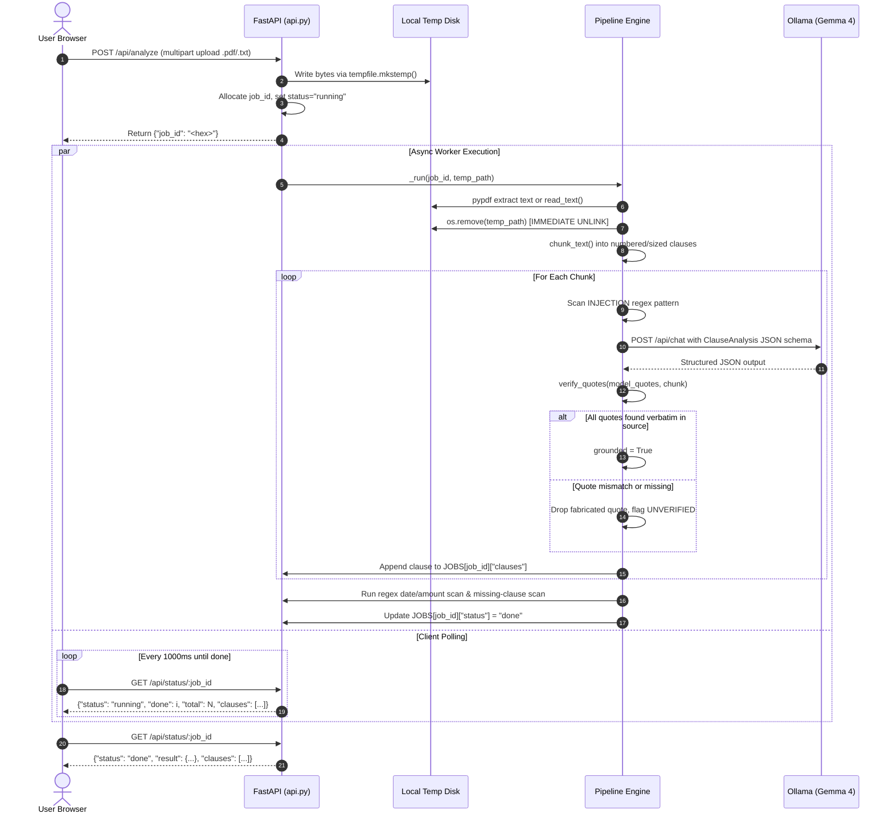
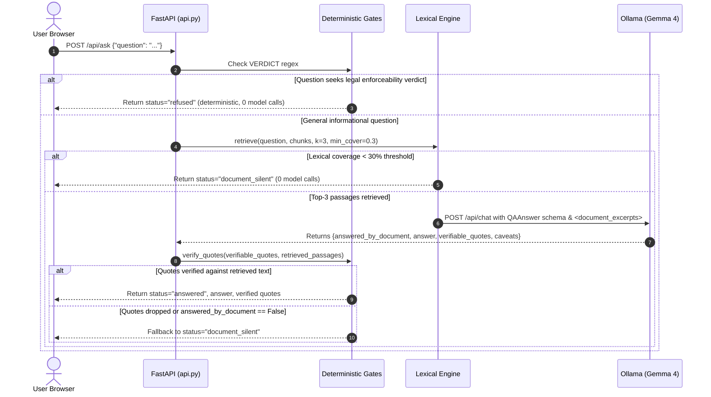
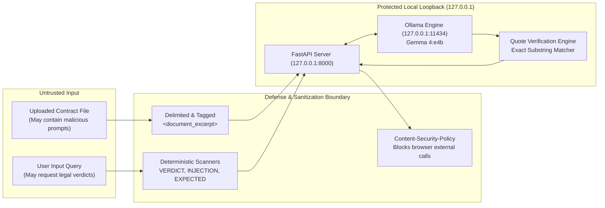

# System Architecture

The **Private Legal Document Triage Agent** is designed from the ground up for strict privacy, predictability, and verifiable document understanding. It operates as an entirely local, on-device pipeline where deterministic code handles file processing, safety gates, and citation verification, while a locally hosted Large Language Model (Gemma 4 via Ollama) provides structured natural language interpretation.

---

## 1. High-Level Component Architecture

### Mermaid Diagram

```mermaid
graph TD
    User([User Browser])
    
    subgraph Host ["Local Host (127.0.0.1)"]
        subgraph WebServer ["FastAPI Web Server (Port 8000)"]
            Static[Static Single-Page UI]
            Endpoints[REST API: /analyze, /status, /ask, /clear]
            Middleware[Security Headers Middleware: Strict CSP]
        end

        subgraph Pipeline ["Triage Pipeline Engine (pipeline.py)"]
            Ingest[Ingest: pypdf / Path.read_text]
            Chunker[Chunker: Header & Sentence Splitter]
            VerdictGate{Verdict Refusal Gate<br>VERDICT Regex}
            InjectionGate{Prompt Injection Gate<br>INJECTION Regex}
            LexicalRetrieval[Lexical Retrieval<br>5-char stemmer + IDF]
            QuoteVerifier[Quote Verifier: _norm & Substring Check]
            KeywordScan[Keyword Completeness Scan]
        end

        subgraph EdgeLLM ["Local Inference Engine (Port 11434)"]
            Ollama[Ollama Server]
            Gemma[Gemma 4:e4b<br>Structured JSON Schema]
        end

        subgraph Storage ["Volatile Memory & Temp Storage"]
            TempDisk[(Ephemeral Temp File<br>Deleted post-read)]
            RamState[(In-Memory Python RAM<br>STATE['chunks'] & JOBS)]
        end
    end

    User -->|HTTP GET /| Static
    User -->|POST /api/analyze| Endpoints
    User -->|GET /api/status/:id| Endpoints
    User -->|POST /api/ask| Endpoints
    User -->|POST /api/clear| Endpoints

    Endpoints --> TempDisk
    TempDisk --> Ingest
    Ingest --> Chunker
    Chunker --> RamState
    Chunker --> InjectionGate
    InjectionGate --> Ollama
    Ollama --> Gemma
    Gemma --> QuoteVerifier
    QuoteVerifier --> RamState
    KeywordScan --> RamState

    Endpoints --> VerdictGate
    VerdictGate -->|Refuse Verdict| Endpoints
    VerdictGate -->|Allow Query| LexicalRetrieval
    LexicalRetrieval --> RamState
    LexicalRetrieval -->|Coverage < 30%| Endpoints
    LexicalRetrieval -->|Top-3 Passages| Ollama
    Ollama --> Gemma
    Gemma --> QuoteVerifier
```

### ASCII Fallback Diagram

```
+---------------------------------------------------------------------------------+
| LOCAL MACHINE ONLY (127.0.0.1)                                                  |
|                                                                                 |
|  [ User Browser ]                                                               |
|         |                                                                       |
|         v (HTTP on 127.0.0.1:8000)                                              |
|  +---------------------------------------------------------------------------+  |
|  | FASTAPI SERVER (api.py)                                                    |  |
|  |  - Injects Content-Security-Policy (blocks outbound loads)                 |  |
|  |  - POST /api/analyze  -> Spawns async background analysis worker         |  |
|  |  - GET  /api/status   -> Returns progress & streamed clause results       |  |
|  |  - POST /api/ask      -> Evaluates question against active document       |  |
|  |  - POST /api/clear    -> Wipes in-memory chunks & active jobs             |  |
|  +---------------------------------------------------------------------------+  |
|         |                                            |                          |
|         v                                            v                          |
|  +---------------------------+              +--------------------------------+  |
|  | VOLATILE MEMORY / RAM     |              | DETERMINISTIC SAFETY CONTROLS  |  |
|  |  - STATE["chunks"]        |              |  - VERDICT Regex (refuses      |  |
|  |  - JOBS[job_id]           |              |    enforceability queries)     |  |
|  |  (Ephemeral: no DB files) |              |  - INJECTION Regex (flags AI   |  |
|  +---------------------------+              |    jailbreaks in contract)     |  |
|         ^                                   |  - Lexical IDF Retrieval       |  |
|         |                                   |  - verify_quotes() Substrings  |  |
|         v                                   +--------------------------------+  |
|  +---------------------------------------------------+        |                 |
|  | LOCAL OLLAMA SERVER (127.0.0.1:11434)             | <------+                 |
|  |  - Model: gemma4:e4b                              |                          |
|  |  - Temperature: 0.1, Schema format enforced       |                          |
|  |  - Zero internet calls at runtime                 |                          |
|  +---------------------------------------------------+                          |
+---------------------------------------------------------------------------------+
```

---

## 2. Sequence Diagrams

### A. Document Upload, Analysis & Progress Polling



#### ASCII Fallback: Upload & Analysis Workflow
```
[User Browser]                   [FastAPI (api.py)]               [Local Ollama]
      |                                   |                                |
      |--- 1. POST /api/analyze --------->|                                |
      |                                   |-- 2. Write tempfile            |
      |<-- 3. Return {"job_id": "..."} ---|                                |
      |                                   |-- 4. read_document()           |
      |                                   |-- 5. os.remove(tempfile)       |
      |                                   |-- 6. chunk_text()              |
      |                                   |                                |
      |                                   |-- 7. Chat (schema enforced) -->|
      |                                   |<-- 8. Return Clause JSON ------|
      |                                   |                                |
      |                                   |-- 9. verify_quotes()           |
      |--- 10. GET /api/status/:id ------>|                                |
      |<-- 11. Return incremental clauses-|                                |
      |                                   |                                |
      |--- 12. GET /api/status/:id ------>|                                |
      |<-- 13. Return completed results --|                                |
```

---

### B. Grounded Question Answering (Document Silent / Refused / Answered)



#### ASCII Fallback: Question Answering Workflow
```
Query: "Is this clause enforceable?"
  [User] --> [VERDICT Regex] --(Match!)--> Refused immediately. No LLM call.

Query: "Can I keep a dog?" (Topic absent from lease)
  [User] --> [VERDICT Regex] --(Pass)--> [Lexical Retrieval] --(Coverage < 30%)-->
  --> Returns "document_silent". No LLM call.

Query: "Can I sublet the apartment?" (Topic present)
  [User] --> [VERDICT Regex] --(Pass)--> [Lexical Retrieval] --(Top-3 Excerpts)-->
  --> [Ollama Gemma 4] --> [verify_quotes()] --(Verbatim Match)-->
  --> Returns status="answered" with verified citation substrings.
```

---

## 3. Data Flow & Lifecycle Management

| Data Artifact | Location | Storage Type | Creation Event | Deletion / Purge Trigger |
| :--- | :--- | :--- | :--- | :--- |
| **Uploaded Document** | OS Temp Directory | Ephemeral Disk (`tempfile.mkstemp`) | Upload via `/api/analyze` | Explicitly unlinked in `_run()` `finally` block immediately after text extraction |
| **Document Text Chunks** | Process RAM (`STATE["chunks"]`) | Volatile Memory | Chunking step in `_run()` | Purged on `/api/clear`, new upload, or server process shutdown |
| **Analysis Results & Clauses**| Process RAM (`JOBS[job_id]`) | Volatile Memory | Incremental chunk evaluation | Purged on `/api/clear` or server process shutdown |
| **Extracted Quotes & Caveats**| Process RAM (`JOBS[job_id]`) | Volatile Memory | Schema validation & quote check | Purged on `/api/clear` or server process shutdown |
| **Browser Render State** | Browser DOM (`allClauses`) | Client RAM | Incremental status poll | Purged on page reload or "Clear document" click |

---

## 4. Trust Boundaries & Loopback Isolation



All network sockets are bound exclusively to the loopback interface (`127.0.0.1`). Neither the FastAPI server nor the Ollama inference daemon opens listening sockets on public network interfaces (`0.0.0.0`).

---

## 5. Division of Responsibilities: AI vs. Deterministic Code

| Pipeline Function | Responsible Component | Engine | Justification / Technical Rationale |
| :--- | :--- | :--- | :--- |
| **Document Ingestion** | Deterministic Code | `pypdf` / `Path.read_text` | LLMs cannot reliably ingest binary PDF streams. Deterministic parser ensures exact byte-level character fidelity. |
| **Heading & Length Chunking** | Deterministic Code | Python `re` & Sentence Splitter | Preserves legal section numbering and prevents context window overflow without model latency. |
| **Prompt Injection Defense** | Deterministic Code + AI Framing | `INJECTION` regex + `<document_excerpt>` | Code flags malicious instructions deterministically and forces lawyer escalation; tags instruct LLM to treat excerpt as untrusted data. |
| **Clause Explanation & Synthesis**| AI Model | Gemma 4 (`gemma4:e4b`) | Natural language comprehension, restructuring legalese into plain English, and distinguishing explicit statements from interpretation. |
| **Output Structure Enforcement** | Deterministic Code | `pydantic` JSON Schema | Eliminates arbitrary unstructured model chatter; guarantees strict JSON parsing with typed fields. |
| **Citation Verification** | Deterministic Code | `verify_quotes()` Substring Matching | **Critical anti-hallucination barrier**. LLMs frequently hallucinate or paraphrase quotes. Code guarantees quotes are verbatim substrings. |
| **Legal Advice / Verdict Refusal** | Deterministic Code | `VERDICT` regex | Models cannot be trusted to refuse enforceability queries consistently. Deterministic regex intercepts verdict questions with zero model calls. |
| **Topic Silence Detection** | Deterministic Code | Lexical Stemmer + IDF Coverage | If a contract does not mention a topic, calling an LLM invites hallucinations. Code returns "document is silent" if keyword coverage < 30%. |
| **Grounded Question Answering** | AI Model | Gemma 4 (`gemma4:e4b`) | Synthesizes an answer restricted strictly to the top-3 retrieved excerpts. |
| **Missing Clause Sanity Check** | Deterministic Code | `EXPECTED` regex patterns | High-speed keyword check for fundamental protections (notice, deposit, governing law) without token consumption. |
| **Financial & Date Extraction** | Deterministic Code | Regex (`AMOUNT`, `DATE`) | Deterministic regex guarantees zero numerical hallucination for financial values ($ / ₹) and dates. |
